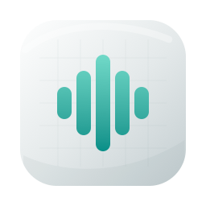

<div align="center">



# VoiceGrep для Android

**Ваши встречи с Mac — в кармане.**

Компаньон к [VoiceGrep для Mac](https://github.com/ilyabazhenov/voicegrep-releases): встречи, расшифровки,
участники и ассистент на телефоне. Встречи по-прежнему хранит и обрабатывает Mac.

[](https://github.com/ilyabazhenov/voicegrep-android/releases/latest)


[](#обновления)

**[Скачать APK](https://github.com/ilyabazhenov/voicegrep-android/releases/latest)** ·
[voicegrep.com](https://voicegrep.com/ru/#phone) ·
[English](README.en.md)

</div>

VoiceGrep на Mac записывает звонки, расшифровывает их на устройстве и узнаёт собеседников по голосу.
Приложение для Android — пульт к этому архиву: открыть встречу по дороге, найти, о чём договорились,
подписать нового собеседника или записать встречу в переговорке. Все правки и записи уходят на Mac
и выполняются там.

Это бета. Интерфейс — на русском.

## Что умеет

**Встречи**
- **Поиск по тексту встреч.** Слово из разговора найдёт реплику и откроет встречу прямо на ней.
- **Транскрипт, саммари и задачи** встречи; любую реплику можно послушать.
- **Фильтр по участнику:** нажмите на человека над транскриптом — останутся только его реплики,
  «Подряд» проиграет их одну за другой.

**Участники**
- **Назвать голос без имени** — все его реплики перейдут к человеку, голос запомнится и будет узнаваться
  на следующих встречах.
- **Поправить узнавание:** перенести реплики другому человеку или исправить имя во всех встречах.
- **Люди** — список и карточки собеседников.

**Ассистент**
- **Вопросы по встречам** — отвечает ассистент Mac, беседы общие с Mac.
- **«Итоги дня»:** что решили, что вы взяли на себя, что вам обещали.
- Нужна языковая модель, подключённая в VoiceGrep на Mac.

**Запись в комнате**
- Красная кнопка внизу экрана записывает встречу вживую. Запись уезжает на Mac и расшифровывается там,
  как обычный звонок; копия на телефоне удаляется, только когда Mac её получил.

## Установка

1. Установите [VoiceGrep для Mac](https://github.com/ilyabazhenov/voicegrep-releases) 1.12.0 или новее.
2. **[Скачайте APK](https://github.com/ilyabazhenov/voicegrep-android/releases/latest)** на телефон и откройте его.
   Android попросит разрешить установку из этого источника.
3. На Mac: «Настройки → Данные → Телефон», включите «Доступ с телефона» (по умолчанию выключено).
4. Там же «Подключить телефон…» — появится QR-код. Отсканируйте его в приложении. В первый раз телефон
   и Mac должны быть в одной сети Wi-Fi; код одноразовый и действует 5 минут.

**Требования:** Android 10 или новее; Mac с VoiceGrep, который включён и не спит.

**Вне дома** телефон подключается через relay (переключатель «Подключаться через relay» в том же разделе
настроек на Mac).

## Обновления

Через [Obtainium](https://github.com/ImranR98/Obtainium): «Add App» → адрес

```
https://github.com/ilyabazhenov/voicegrep-android
```

Obtainium сам найдёт новые версии в релизах этого репозитория. Без него — скачайте APK из
[последнего релиза](https://github.com/ilyabazhenov/voicegrep-android/releases/latest) и установите поверх.

## Приватность

Mac остаётся главным: встречи, аудио и обработка — на нём.

| Что | Где |
|---|---|
| Аудио звонков, расшифровка, узнавание голосов | на Mac |
| Голосовые отпечатки | на Mac, на телефон не передаются |
| Встречи, которые вы открывали | копия на телефоне, чтобы открывались быстрее |
| Запись в комнате | на телефоне, пока Mac её не получит |
| Ушло в облако | **0 байт**: relay передаёт только зашифрованные данные и не видит встреч |

Связь с Mac — TLS 1.3, телефон и Mac знают ключи друг друга с момента сопряжения. Раз на телефоне
лежат копии расшифровок, приложение при открытии (и через минуту в фоне) спрашивает отпечаток, лицо
или код блокировки экрана. Отключить телефон — «Настройки → Данные → Телефон → Отозвать» на Mac:
доступ пропадает сразу.

**Разрешения:** «Камера» — отсканировать QR-код, «Микрофон» — записать встречу в комнате,
«Уведомления» — показывать, что идёт запись или отправка на Mac.

## Обратная связь

Нашли ошибку или есть идея — [пишите в Telegram](https://t.me/ilyabazhenov).

## Что лежит в этом репозитории

Код приложения закрыт. Здесь — только сборки:

| Что | Где |
|---|---|
| `VoiceGrep-Android-<версия>.apk` | [Releases](https://github.com/ilyabazhenov/voicegrep-android/releases) |
| Сборки для Mac, сайт, лента обновлений | [voicegrep-releases](https://github.com/ilyabazhenov/voicegrep-releases) |

<sub>Проверка подлинности: все APK подписаны одним ключом, SHA-256 сертификата
`D3:31:ED:88:87:A2:B7:75:B1:18:42:08:F4:4E:39:8F:6C:4A:8A:74:8F:C6:03:BA:C9:77:95:D8:99:FD:6C:2D`.</sub>

---

<div align="center">
<sub>VoiceGrep — локальная запись и расшифровка звонков. Телефон — пульт, данные остаются на вашем Mac.</sub>
</div>
